# Cinematic Lighting and Visual Lab

Open the built game with `?dev=lighting`. Collapse the Visual Lab with its summary. Time, five time shortcuts, cycle pause/run, Original/Neutral, Chrome, Negative and Gold, streetlight Auto/On/Off, clouds, glare and mist update the current scene without a reload. Reset restores URL/default settings. The panel is DOM and is never graded. Keyboard events focused in the panel do not drive; pointer interaction releases held movement keys.

## Responsibilities

- `src/visual/daylight.mjs`: existing solar arc, cloud field, exposure and sky. Preserves the merged midday/twilight exposure bounds. Evening sun tint and skydome halo are warmer; camera glare is stronger at low sun angles without raising direct sunlight. Solar disc intensity is unchanged. A CPU sample of the existing projected procedural cloud field estimates sun coverage and smoothly attenuates sunlight/glare. This is an approximation, not physical sun occlusion.
- `src/visual/street-lighting.mjs`: pure deterministic road placement and schedule plus renderer adapter. Replaces the old capped 40-pole furniture generator with 302 mapped-road poles at roughly 52 m spacing, alternating sides, minimum 36 m separation. Rejects building bounds with 3 m clearance, water, steep terrain, all nearby road/path corridors and world edges. No gameplay RNG calls. Existing cylindrical pole/box fixture geometry is instanced with shared materials.
- Four fixed non-shadow-casting PointLights near the camera (two for coarse-pointer devices), range 26 m, amber color, plus emissive fixtures and radial depth-tested sprite diffusion. All fixtures glow; only the selected nearest budget has real local illumination. Halos are distance-culled at 180 m. No extra shadow maps, fullscreen passes or runtime libraries. Lamp schedule turns on at 19:00, off at dawn; real-time intensity fades exponentially rather than flashing. Fixed pool avoids recompiling every material as the player moves.
- `src/visual/film-pipeline.js`: existing shared creative grade and one sRGB transfer. New `setFilmPreset` changes only grading uniforms. Neutral bypasses creative grading while keeping ACES and lighting. Chrome now has a gentler curve than Negative, muted pigments and cooler blues; Negative retains its characterful reference, Gold emphasizes amber/yellow and warmer midtones. Legacy Portra URL remains supported outside the four-option lab.
- `src/visual/visual-lab.js`: opt-in DOM controls, no world generation or player resets. `tools/build.py` embeds the modules into the existing standalone game. `src/game.html` only wires adapters and the normal frame update.

For the future Vite/TypeScript migration, keep pure placement/schedule functions separate from the renderer adapters; import these modules directly and type the small controller interfaces. Do not duplicate sky, tone mapping or encoding when upgrading Three.js.

## Evidence

[Browser results and capture timings](lighting-lab/results.json). `node tools/capture-lighting-lab.cjs` runs the real game with browser-only deterministic frame/camera instrumentation. It dispatches real control input/change events. Simulation and cloud time remain frozen during matched profiles. Images are actual Chromium WebGL captures at 960 × 540; the first view shows the panel expanded and later views collapse it for inspection. The minimap/HUD remains at the player's location while the review camera is positioned independently.

| 13:00 | 17:00 | 19:00 | 20:30 | 22:00 |
| --- | --- | --- | --- | --- |
| [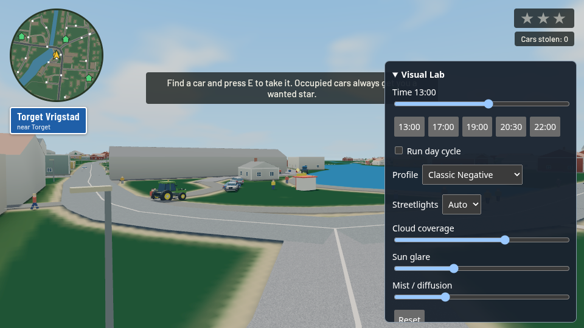](lighting-lab/time-13.png) | [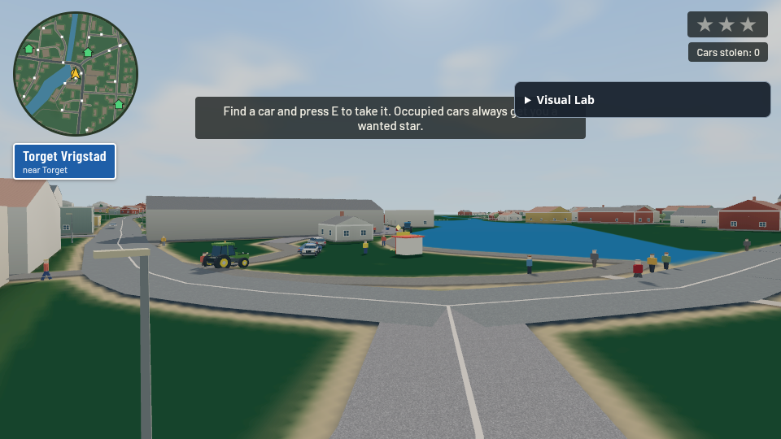](lighting-lab/time-17.png) | [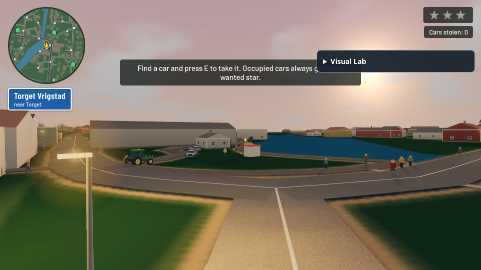](lighting-lab/time-19.png) | [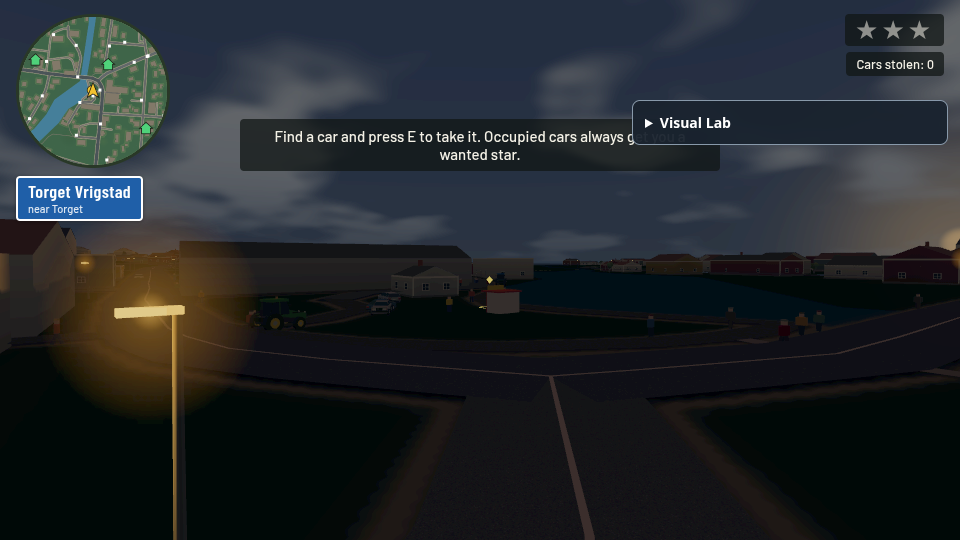](lighting-lab/time-20.5.png) | [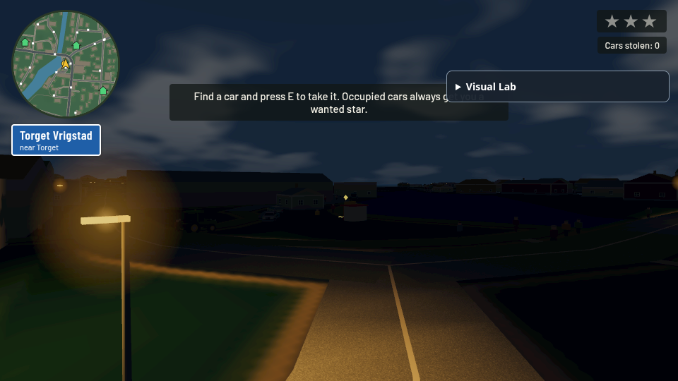](lighting-lab/time-22.png) |

| Time | Neutral | Chrome | Negative | Gold |
| --- | --- | --- | --- | --- |
| 13 | [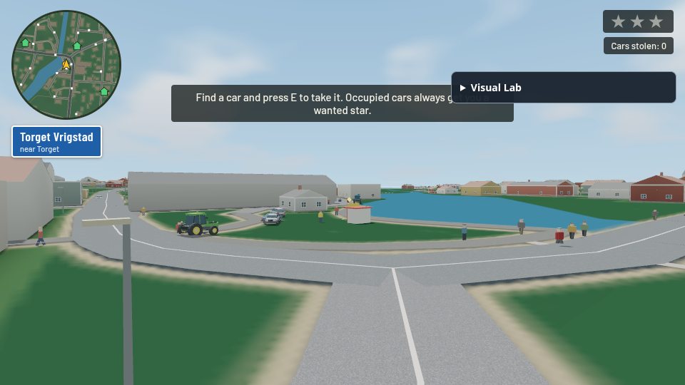](lighting-lab/13-off.png) | [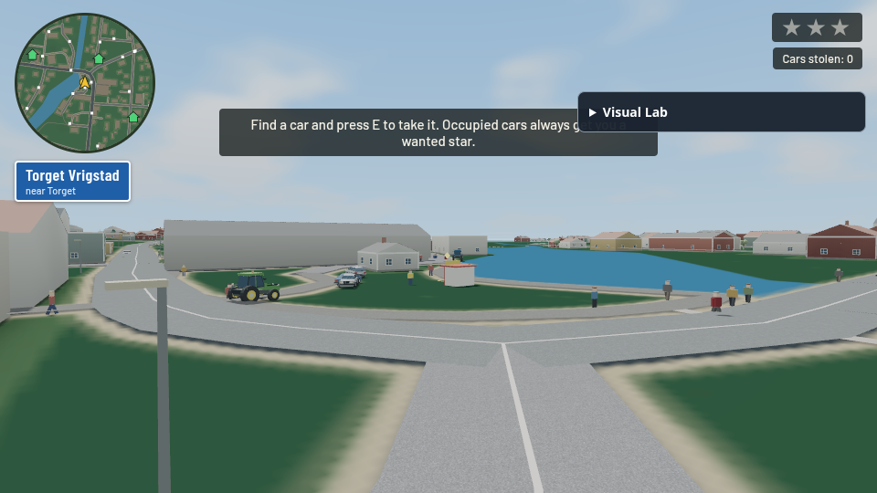](lighting-lab/13-chrome.png) | [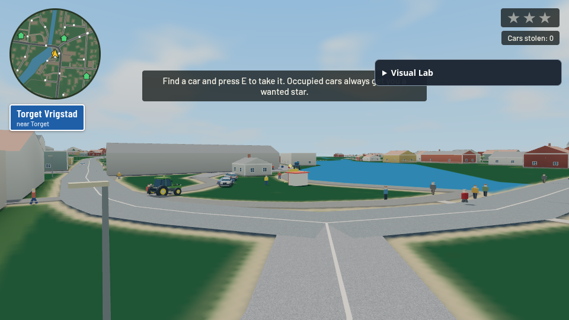](lighting-lab/13-negative.png) | [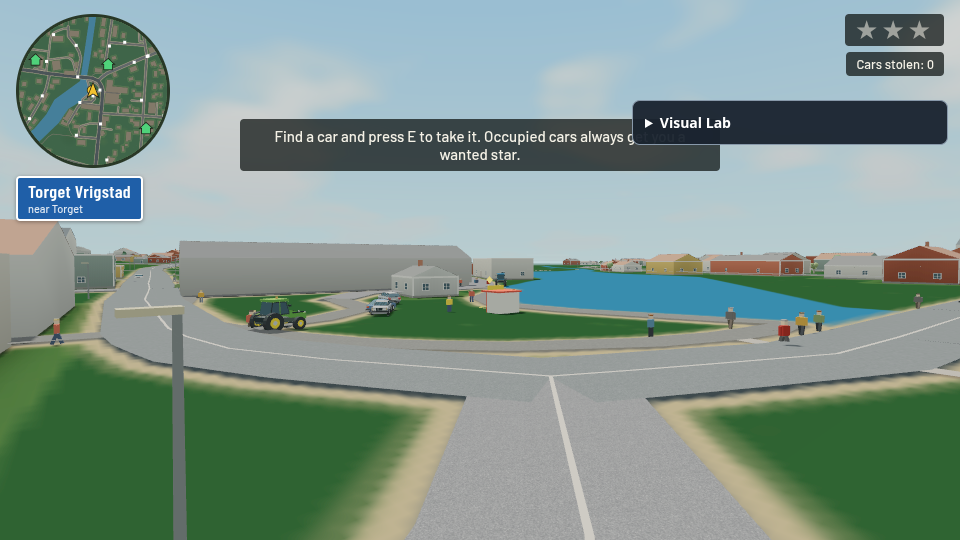](lighting-lab/13-gold.png) |
| 20:30 | [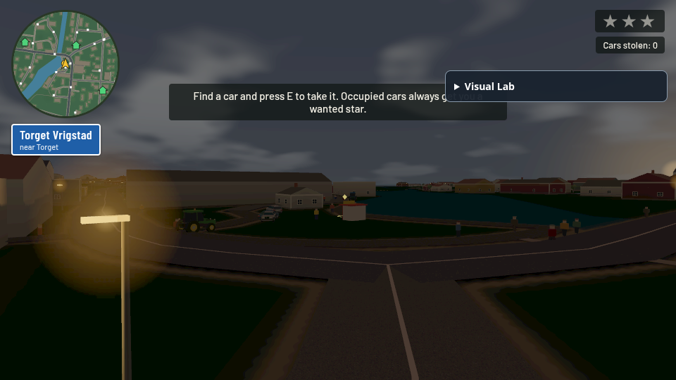](lighting-lab/20.5-off.png) |  |  | [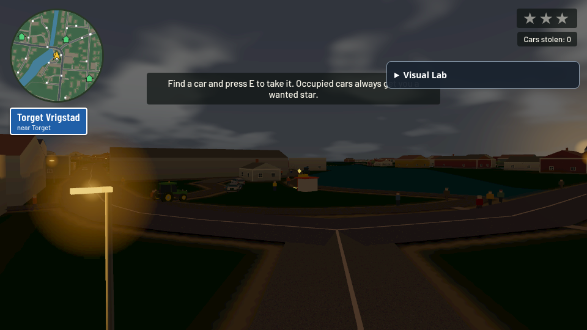](lighting-lab/20.5-gold.png) |

| Night lamps off | Night lamps on | Clear sun | Cloudy sun |
| --- | --- | --- | --- |
| [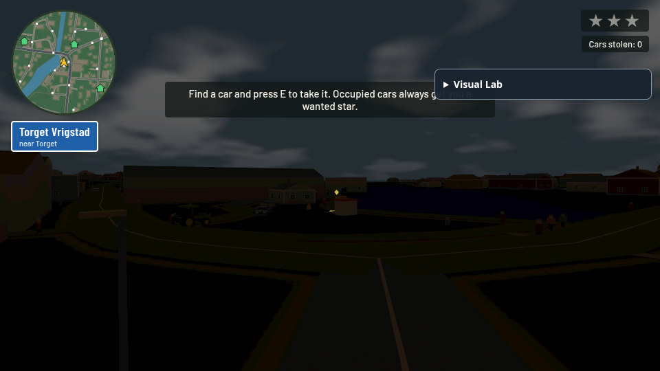](lighting-lab/night-street-off.png) | [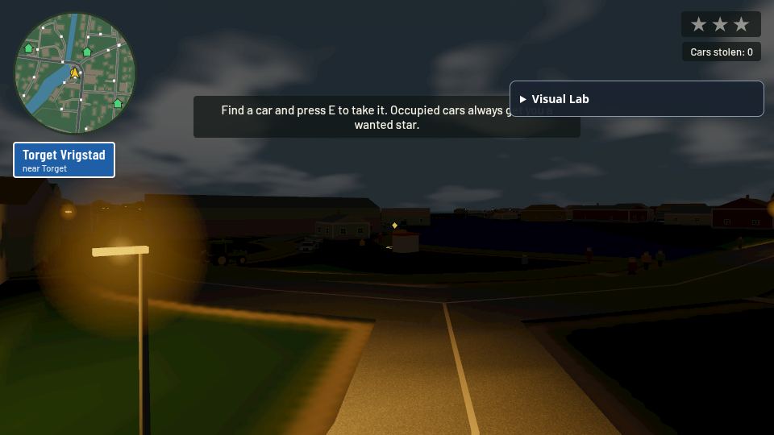](lighting-lab/night-street-on.png) | [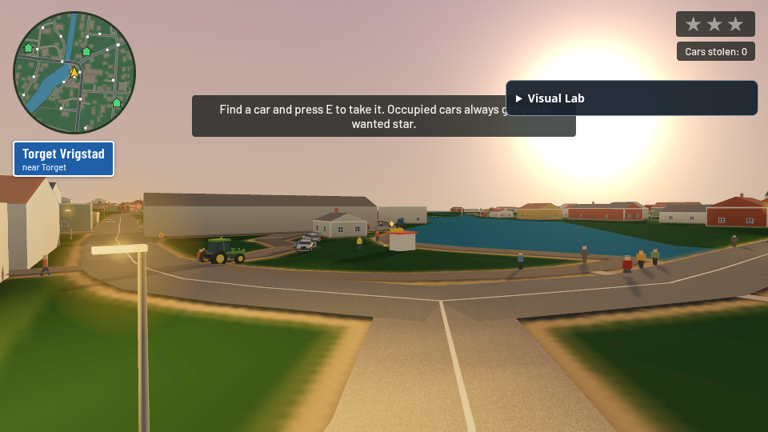](lighting-lab/sun-clear.png) | [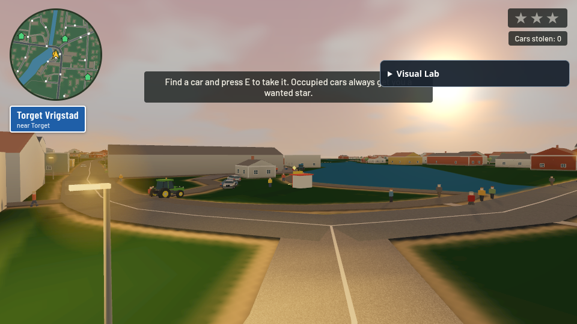](lighting-lab/sun-cloudy.png) |

## Verification and limits

Pure tests cover schedule including morning, deterministic spacing, building rejection, slope rejection, cloud attenuation and exposure bounds. Existing daylight/house/residential checks and Python build are required. Browser assertions cover shader/page errors, profile state isolation, overlay keyboard isolation, normal keyboard movement and reset. The capture JSON reports actual software render + screenshot wall times, not hardware GPU timings or playable FPS. SwiftShader is far too slow for representative interactive performance; hardware desktop/mobile profiling remains required.

The 13:00 view retains pale facade/road separation; evening is warmer and dimmer; 22:00 is dark with visible local sodium pools. The off/on comparison establishes actual local contribution. Neutral is the brightest ungraded reference, Chrome is muted, Negative deepens foliage/shadows and Gold is warmer. Final visual quality remains subject to review; this is a Draft experiment.

Known limits: the pool uses distance priority, not full visibility ranking, and its assignment can change at nearest-neighbor boundaries. PointLights have no shadow maps, so some light leakage through walls is possible. Halo sprites use depth tests but are not volumetric fog. Sun glare retains the existing screen-space model and is not geometry-depth occluded. CPU/GPU cloud noise precision differs; cloud coverage changes are approximate, smoothed for sunlight. Procedural driveways not represented in the road dataset are not individually checked, and guessed terrain/building data cannot establish surveyed lamp locations. No headlights: remote unlit night roads intentionally remain dark. Long manual driving sessions, mobile touch interaction and all weather/time combinations still need review.

### Completed checks

- Build and inline JS syntax: passed. `node tools/check_daylight.mjs`, `node tools/check-lighting-lab.mjs`, `node tools/check_house_catalog.mjs`, `node tools/check_residential_neighborhood.mjs`: passed.
- Seventeen matched browser captures: no shader/page/console errors. At 19:00 four real light slots are active; daytime slots have zero intensity. Identical daylight strengths across each four-profile group confirm lighting isolation.
- Browser assertions: profile preserves state, focused panel blocks movement, canvas keyboard movement works, Reset returns 13:00 / Negative / Auto. No source reload occurs for these checks.
- [Uninstrumented live default](lighting-lab/live-default.png) with [browser results](lighting-lab/live-check.json) also starts without errors, with normal gameplay render loop and default grain/mist. Developer panel is absent outside `dev=lighting`.
- This run measured 4.4–19.6 seconds per software render plus browser capture, including cold work and capture overhead. These timings establish no hardware performance equivalence. No hardware desktop/phone FPS measurement was available.
- The clear/cloudy images deliberately use glare **3** (stress setting), not the default **1** shown in the time-of-day sequence. The large solar bloom in the stress shot is an adjustable upper extreme, not the default look.
