# Photographic color grading study

[Open the comparison gallery](film-study/index.html). Four photographic interpretations, not exact reproductions of Fujifilm or Kodak proprietary transforms. Classic Negative remains the default.

## Implementation

- [`src/visual/film-pipeline.js`](../src/visual/film-pipeline.js): `FILM_PRESETS` supplies curve endpoints/blend, shadow/highlight/midtone RGB biases, highlight shoulder strength, foliage channel factors, separate red/yellow/blue/cyan corrections, saturation and neutral protection. `photographicGrade` shares all operations; preset selection changes uniforms only.
- `?film=chrome|negative|gold|portra`, `?film=off`. Missing or unknown values fall back to Negative. Existing `grain=off|subtle|strong` and `mist=off|subtle|strong` are unchanged.
- Negative retains the previous curve, shadow/highlight split, 9.2% luminance shoulder, green reduction and red/blue corrections. New midtone/yellow/cyan terms are zero and neutral protection is disabled for this reference.
- Neutral protection for other looks gates split-tone tint by source chroma, preserving grey/white surfaces while allowing warmth in pigments. Hue selection is deliberately broad RGB-difference masking, not a calibrated film spectral model.
- One existing scene render into the linear ACES target, one sRGB transfer, one creative transform and the existing effects in the existing final pass. No extra texture fetches, render targets, passes or runtime dependencies. Grain, mist mask, sun glare, sky, fog, shadow generation and DOM overlays retain their existing code.
- [`src/game.html`](../src/game.html), geometry, materials, simulation, input and camera behavior are unmodified. Generated [`index.html`](../index.html) is rebuilt with the existing Python build.

## Reproduction

```sh
python3 tools/build.py
node tools/capture-film-study.cjs
```

The capture tool requires development-only Playwright plus Chromium; it uses `/usr/bin/chromium` unless `CHROMIUM_PATH` is supplied. It starts a local HTTP server on port 8765. Run from the repository root with that port free. No new production package is required.

[`tools/capture-film-study.cjs`](../tools/capture-film-study.cjs) instruments only the HTML response in the browser, leaving checked-in game code untouched. It clicks Start through the real DOM handler and advances 12 fixed 1/60 s simulation frames. Intermediate simulation steps omit rendering in the browser-only harness; the complete scene is rendered for each capture pose. It then places the camera at four real locations (and recenters the existing directional-light shadow coverage without changing sun direction, intensity or exposure) and freezes simulation. Every preset at a location processes the very same frozen scene target through the real final pass; assertions compare camera quaternion, position, vehicle state, player position, exposure and sunlight coordinates. Primary captures use `lighting=off` to select the existing static lighting, `grain=off`, `mist=off`, 1280 × 720, device scale 1. Eye/target y coordinates are terrain-relative metres. Exact poses and observed state are in [`results.json`](film-study/results.json).

The camera is placed directly for review rather than changing the gameplay camera. The HUD/minimap continues to represent the player at Torget; this is expected in the remote camera views. Four extra Torget captures enable both default grain and mist. Browser errors and keyboard smoke results are recorded separately from the screenshots.

## Rendering integration / upstream

Reviewed upstream [PR #116](https://github.com/OliverRomhagen/vrigstad-joyride/pull/116): its ACES + sRGB canvas output, `col()` conversions, texture encoding, retuned light levels, FogExp2 and gradient sky overlap with this fork's rendering authority. Stacking that implementation here would risk a second transfer/sky and change the comparison lighting. This study retains the fork's reconciled rendering foundation. It does not apply #116 again.

The branch is based on fork main `6539a39`, including the merged daylight/sky-brightness change (#23). Open fork [PR #24](https://github.com/AxelTidehorn/vrigstad-joyride/pull/24) changes daylight exposure and the sun-disc strength outside the creative transform; preserve those decisions when reconciling branches. Static `lighting=off` captures retain the same light, sky brightness 1 and exposure 1.03 on this base. Upstream's open #122 concerns cats/NPCs; it was not modified. The upstream repository receives no commits, issues or pull requests from this work.

For the planned Vite/TypeScript architecture, export the plain preset records from a typed visual module and keep uniform binding in the render layer. Retain DOM UI separation. Re-evaluate transfer placement and shader chunks when upgrading Three.js; modern color-management defaults differ from r128. Do not copy the legacy conversion setup blindly into a modern renderer.

## Limits

The shared shader adds arithmetic and uniforms, though no texture samples or passes. This is not evidence of performance equivalence. Chromium software WebGL screenshots cannot establish hardware GPU timing, mobile performance, driver portability or long driving-session behavior. Hardware desktop/mobile profiling and maintainer visual approval remain required.

The source map palette, mixed legacy material color conventions and 8-bit intermediate bound the available range; creative grading cannot recover detail already clipped before the pass. RGB masks can affect mixed hues and cannot identify materials. Static daylight captures do not cover all dynamic daylight hours or weather; additional sunset/night review is needed before making a default change.

## Screenshot contact gallery

These links open the original browser captures at full resolution. The HTML gallery provides larger side-by-side panels and separate effects checks.

### Torget

| Classic Chrome | Classic Negative | Kodak Gold 200 | Kodak Portra 400 |
| --- | --- | --- | --- |
| [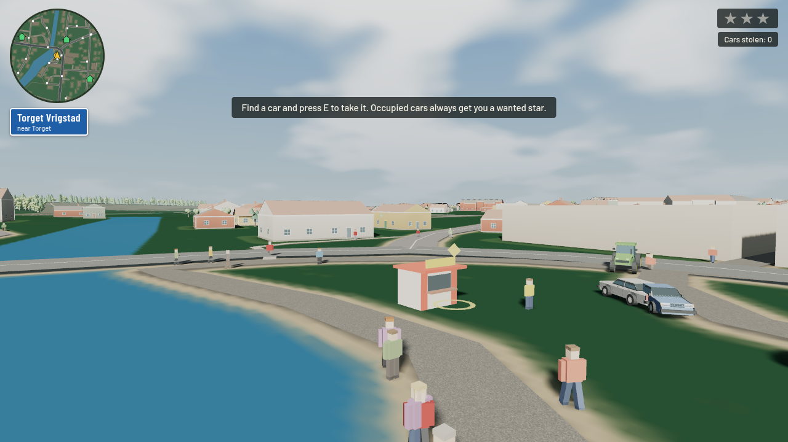](film-study/torget-chrome.png) | [](film-study/torget-negative.png) | [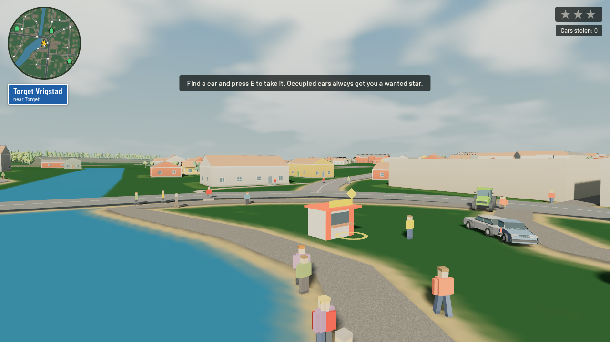](film-study/torget-gold.png) | [](film-study/torget-portra.png) |

[Ungraded Torget](film-study/torget-off.png)

### Residential street

| Classic Chrome | Classic Negative | Kodak Gold 200 | Kodak Portra 400 |
| --- | --- | --- | --- |
| [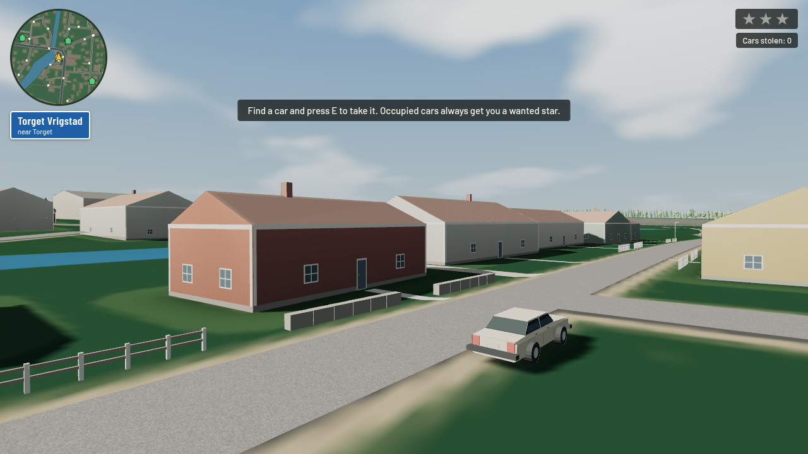](film-study/residential-chrome.png) | [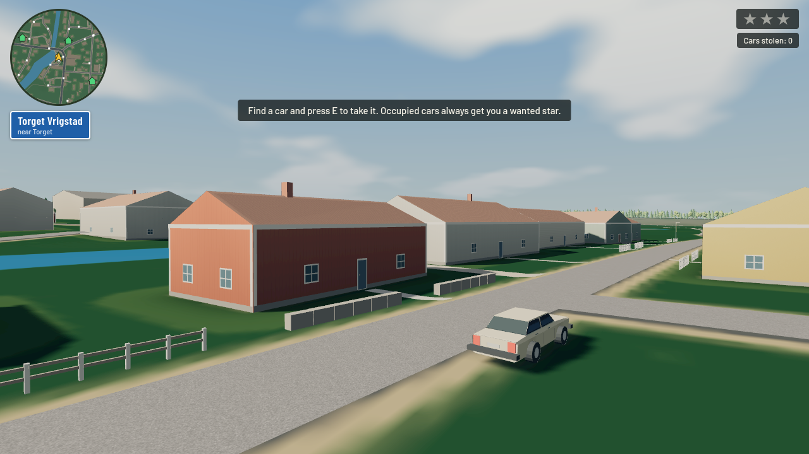](film-study/residential-negative.png) | [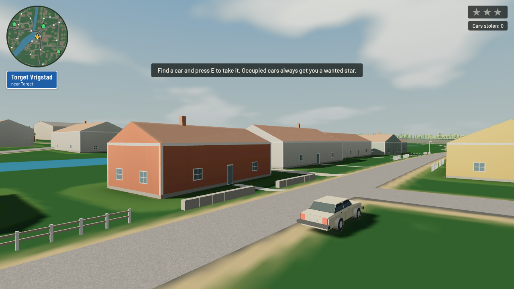](film-study/residential-gold.png) | [](film-study/residential-portra.png) |

[Ungraded residential street](film-study/residential-off.png)

### Rural road

| Classic Chrome | Classic Negative | Kodak Gold 200 | Kodak Portra 400 |
| --- | --- | --- | --- |
| [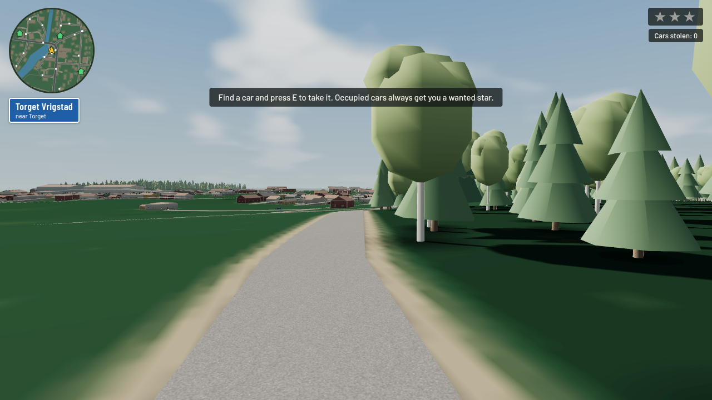](film-study/rural-chrome.png) | [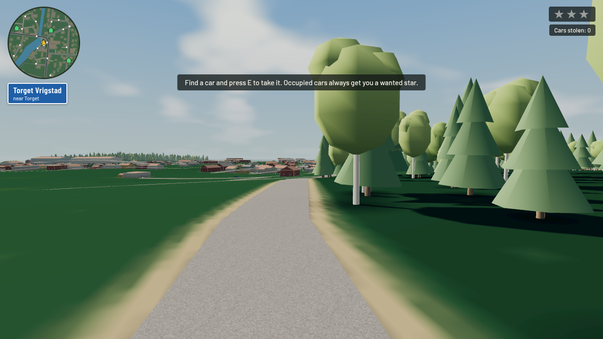](film-study/rural-negative.png) | [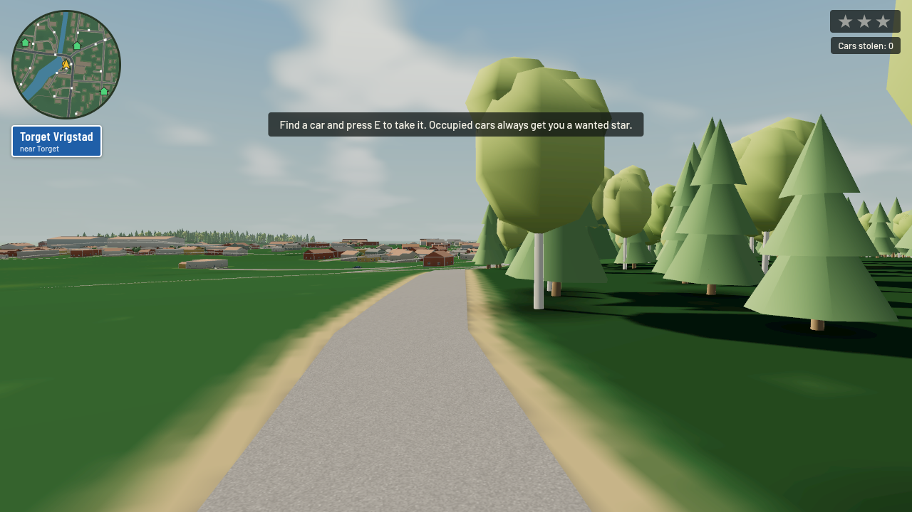](film-study/rural-gold.png) | [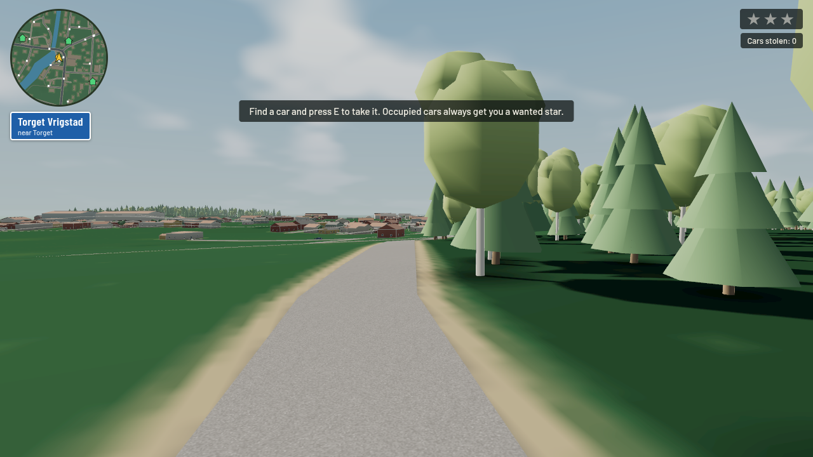](film-study/rural-portra.png) |

[Ungraded rural road](film-study/rural-off.png)

### Industrial area

| Classic Chrome | Classic Negative | Kodak Gold 200 | Kodak Portra 400 |
| --- | --- | --- | --- |
| [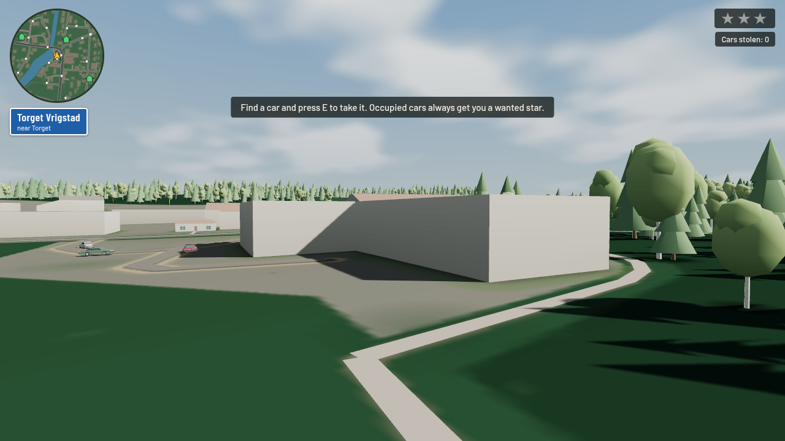](film-study/industrial-chrome.png) | [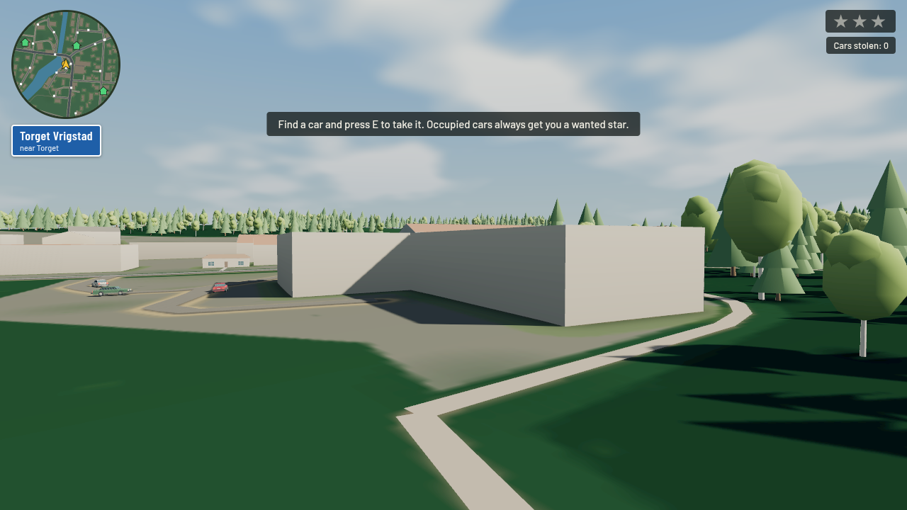](film-study/industrial-negative.png) | [](film-study/industrial-gold.png) | [](film-study/industrial-portra.png) |

[Ungraded industrial area](film-study/industrial-off.png)

## Visual evaluation

Viewed the actual 1280 × 720 captures, including residential sunlit and shadowed red timber, pale façades, yellow paint, car bodywork, sky, trees and industrial building shadows.

| Look | Character and color separation | Highlights and shadows | Swedish-town fit and coherence |
| --- | --- | --- | --- |
| Classic Chrome | Restrained reds/yellows and cooler, less colorful blues; timber is quieter than Negative. | Firm contrast, neutral pale façades, readable dark walls. | Coherent documentary option; can feel austere against the already subdued source palette. |
| Classic Negative | Strongest cool/warm pigment separation; deeper greens and characterful blue water/vehicle colors. | Existing shoulder retains pale surfaces; darkest foliage and cool neutral shadows need review. | Strong character candidate for the town; remains the unchanged reference/default. |
| Kodak Gold 200 | More amber/yellow and warmer red timber; grass is warmer/livelier while sky stays blue. | Gentler curve keeps shadowed façades readable; bright ochre is the main warmth risk. | Most explicit summer nostalgia, with a consistent warm scene rather than a blanket orange cast. |
| Kodak Portra 400 | Gentler pigment contrast, lighter/natural foliage and restrained warmth; less saturated blue than Negative. | Smooth shoulder and softer transitions; good neutral balance and shadow readability. | Strongest balanced alternative: calm, coherent and suitable for buildings plus vegetation; less dramatic than Negative. |

**Candidates to review first: Portra for balance and Negative for character.** Chrome is useful when a restrained documentary mood is preferred; Gold is the clearest warm summer option. This is a recommendation for screenshot review, not a decision to replace the default.

The current lighting/material palette already makes some sunlit red façades look salmon/pastel and some tree crowns pale. These source limitations remain visible in every look; they were deliberately not corrected through scene or light changes during this study. No grading pass can restore missing façade texture or highlight detail from an earlier stage.

## Verification results

- `python3 tools/build.py` passes; generated pages match current source. All embedded JavaScript parses with `node --check`.
- `node tools/check_daylight.mjs`, `node tools/check_house_catalog.mjs`, `node tools/check_residential_neighborhood.mjs` pass. No root npm/test framework exists on this branch.
- Browser capture run: 20 primary images, four effects compatibility images, no reported shader/JavaScript console errors. Every location's preset changes preserve the recorded camera/world/light state. Two successive frozen grain-enabled captures were identical within this run (an observation, not a portable pixel-regression test).
- Keyboard smoke: player moved; parked car entry succeeded; throttle changed vehicle position; braking and exit succeeded. This is a short automated sequence, not a long manual playthrough.
- Fresh URL selection checks confirm Chrome, Negative, Gold, Portra, off (grade uniform 0), and unknown-name fallback to Negative. Grain/mist off uniforms remain zero. The live check also uses the actual default look/effects without a film override.
- [`tools/check-film-browser.cjs`](../tools/check-film-browser.cjs) loads the built game with no source/RAF/camera instrumentation, starts it and captures [default Negative at 13:00](film-study/live-default.png). The only request stub returns an empty favicon. [Live results](film-study/live-check.json): no errors; all 24 gallery screenshot requests succeeded, every image has alt text and the document language is English.
- HUD styles and all DOM rendering remain outside the WebGL pass. Semitransparent HUD backgrounds can visually blend with differently graded scenery beneath them; the UI colors themselves are unmodified.
- Descriptive 8-bit screenshot measurements are in [`image-analysis.json`](film-study/image-analysis.json), reproducible with `python3 tools/analyze-film-study.py` (development-only Pillow). The scene region excludes the top 230 pixels containing the HUD. No sampled scene pixel in the controlled primary comparison reaches 255 in any channel. This supports the absence of final-output clipping in these views; it cannot prove that earlier rendering stages retained all detail.
- The live noon image remains brighter than the controlled static comparison. That behavior belongs to the existing daylight branch and is being addressed separately in fork #24. Full sunset/night visual validation across the four presets remains outstanding.

No hardware GPU timing or FPS equivalence is claimed. The normal pass structure and sample count are unchanged, but the shader has additional arithmetic/uniforms. Measure a representative desktop GPU and phone before deciding the experiment is production-ready.
