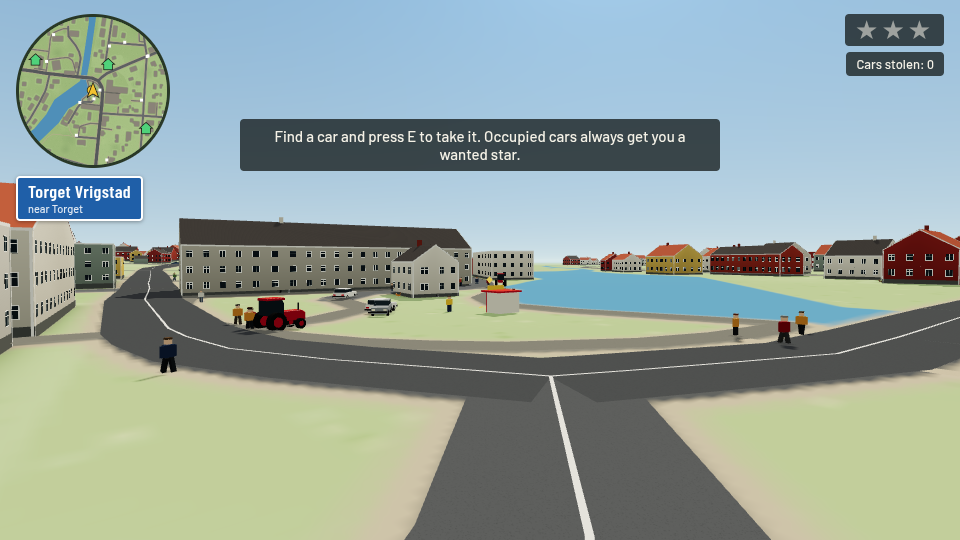
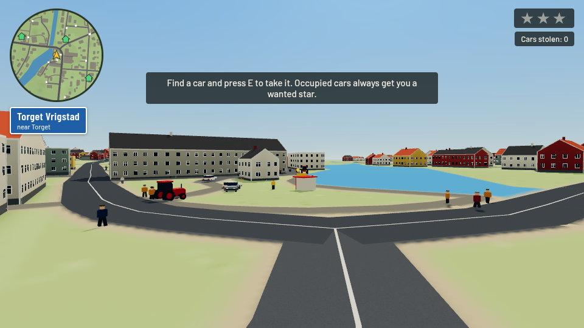
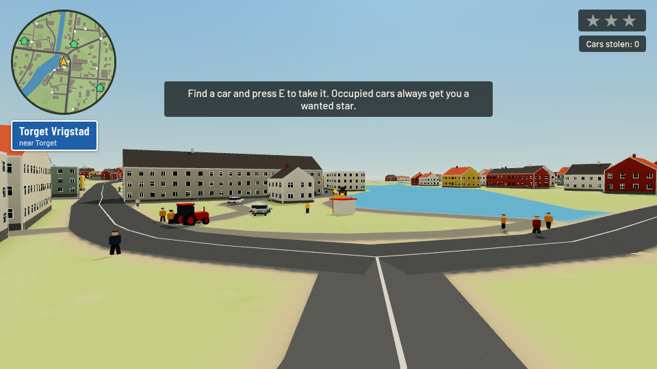
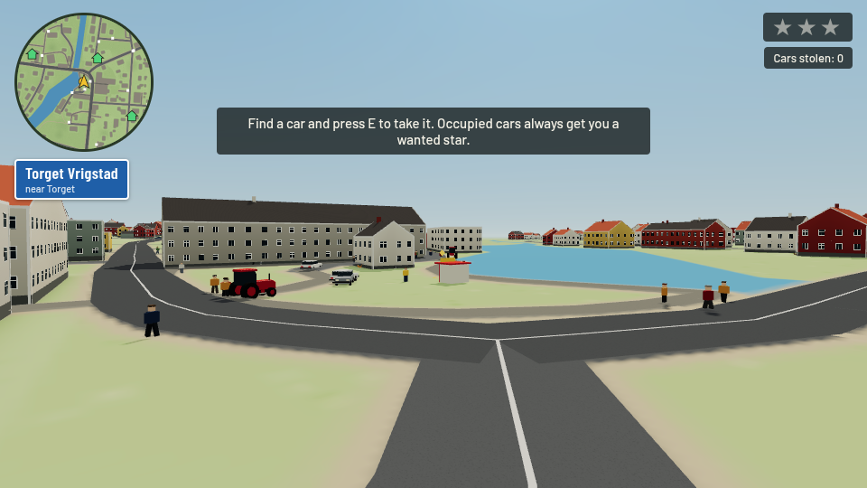
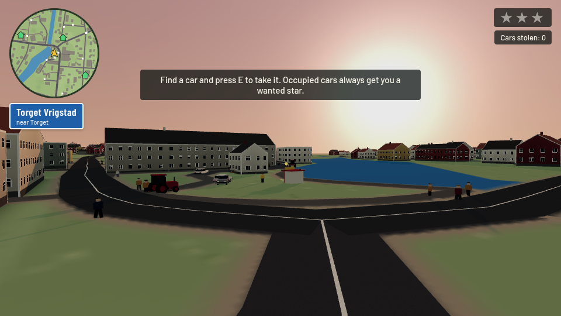
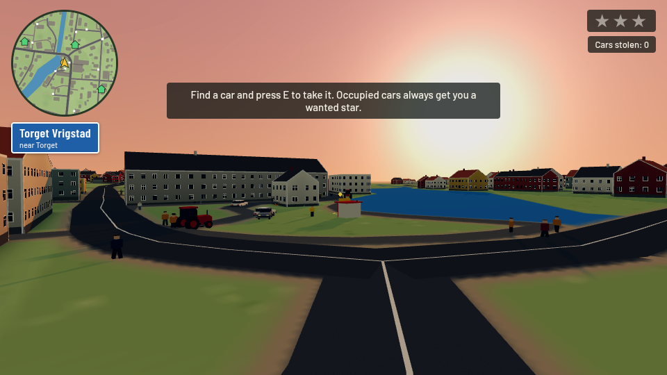
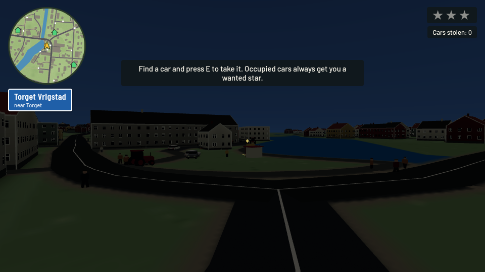
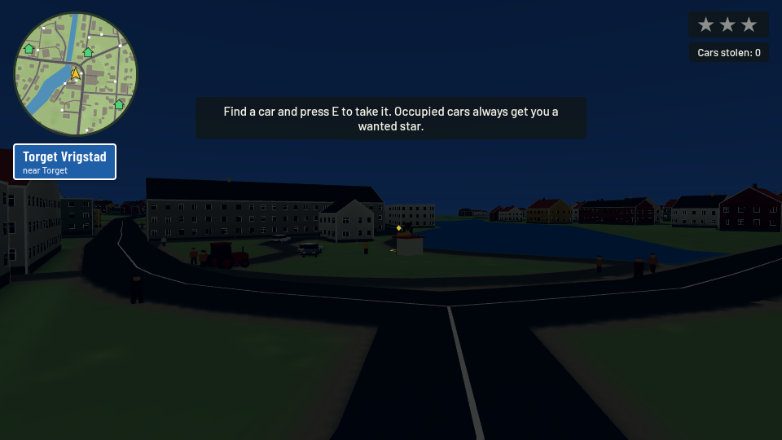
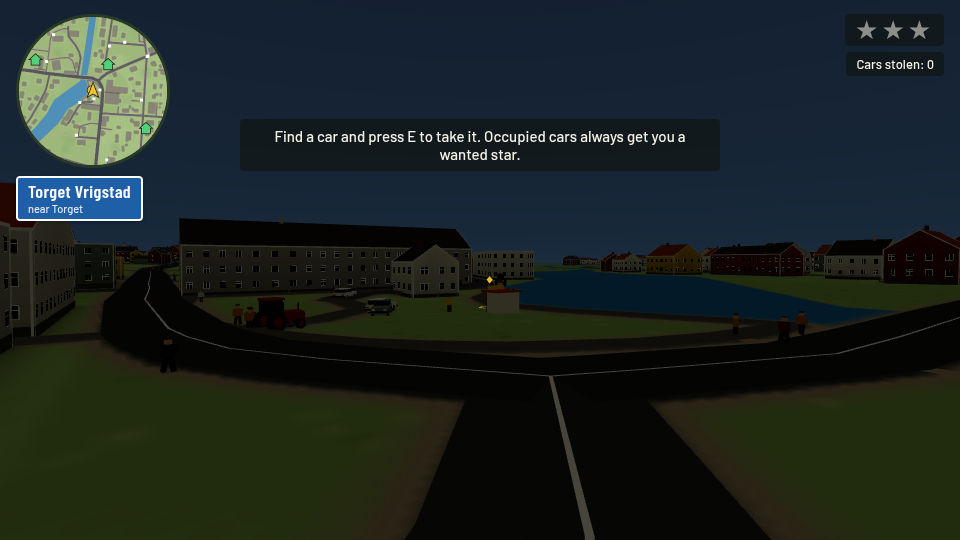
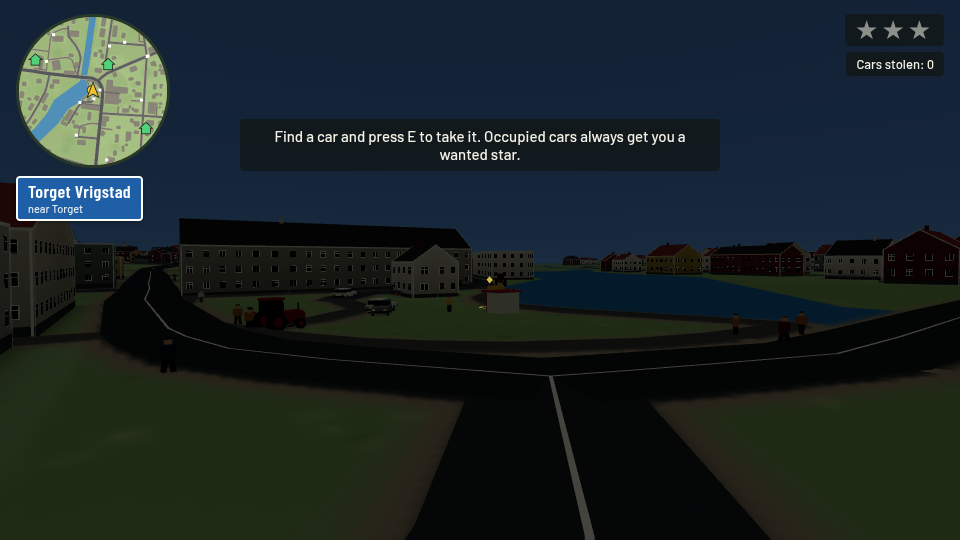

# Optional photographic grades — upstream contribution candidate

Baseline upstream `6466a2fec685bc1d8688704da3e96c6747c295c4`; fork base `review/upstream-baseline-6466a2f`; head `contrib/photographic-grades`. Upstream [upstream #140](https://github.com/OliverRomhagen/vrigstad-joyride/issues/140) is open; it is not declared complete because hardware/phone and maintainer visual criteria remain open.

Upstream already has ACES, explicit sRGB-to-linear material colors, encoded fog and one gradient sky. The fork's `FILM_PRESETS`/`photographicGrade` are extracted into `src/visual/scene-finish.js` without any fork exposure, lighting, sky, mist or grain. There is no grade dependency on daylight or grain branches. Default/missing/off/unknown film names bypass the render target completely, retaining upstream's original look and render call. Only `?film=chrome|negative|gold|portra` enables one shared final color transform.

The scene target retains upstream ACES and sRGB transfer, including r128's encoded-fog convention; raw RGBA8 sampling in the final ShaderMaterial does not perform another decode, encode or tone map. Enabled WebGL2 targets preserve MSAA (4 samples, 2 on coarse devices). Existing canvas textures/material conversions are untouched. DOM HUD/minimap/menus remain separate.

Parameters independently vary curve endpoints/strength, highlight shoulder, shadow/highlight/midtone tint, saturation, selective foliage/red/yellow/blue/cyan corrections and neutral protection. Negative preserves the fork reference; Chrome is quieter/cooler, Gold is warmer/amber and Portra has a softer curve/natural greens. This is artistic interpretation, not proprietary film emulation.

## Matched evidence

`docs/review-grades/` has fifteen **real game-scene WebGL browser captures**: original off plus four looks under identical day, sunset and night lighting fixtures. The fixtures are browser-only: current upstream has no day/night clock. They do not import the fork's renderer and are not claimed as upstream native time/weather support. Within each condition all original geometry, seeded spawn state, camera, fog and light parameters are held identical. The harness records state, light strength/exposure and browser errors. Day uses upstream's actual existing lighting; sunset/night are explicitly controlled test-only fixtures for inspecting the grade under lower/warmer light. They do not constitute a complete future weather/daylight integration signoff.

The off column is the **actual upstream appearance**, unlike the earlier fork study's off column. Review pale facades/sky, red/ochre pigments, grass and shadowed neutral walls. No new default is selected.

Build: `python3 tools/build.py`; smoke suite: `npm run test:e2e`; additional effect tests check default/unknown/off bypass and each preset. Source changes: `src/visual/scene-finish.js`, render/resize/read-only hook wiring in `src/game.html`, embed in `tools/build.py`, generated `index.html`. No map, sim or RNG changes.

## Conflicts / limits

Grain [upstream #124](https://github.com/OliverRomhagen/vrigstad-joyride/issues/124) can later share this final pass; do not stack two full-screen color pipelines. Both contribution branches deliberately stand alone on exact upstream main and must reconcile the shared scene-finish file if adopted together. Disabled grades allocate no target, avoiding baseline cost. Enabled grades add a color/depth/MSAA target and one draw; no representative hardware GPU/phone measurements are available here. An 8-bit target cannot recover earlier clipped detail and broad RGB masks are not material-aware. Validate all daylight/weather combinations and shader portability, especially WebGL1, before choosing a default. The open Vite [upstream #143](https://github.com/OliverRomhagen/vrigstad-joyride/pull/143) and Three.js [upstream #147](https://github.com/OliverRomhagen/vrigstad-joyride/pull/147) migrations will require a source-level rebase and color-space reassessment.

## Reproducing the software review

Install the existing development dependencies and Chromium, then run:

```sh
python3 tools/build.py
node tools/run-software-smoke.cjs
node tools/review-rendering.cjs
```

The software smoke runner copies the repository's existing assertion bodies into `work/software-smoke`, changes only their import to a page fixture, and intercepts HTML responses to suppress WebGL submissions and repeated minimap texture drawing during **functional-only** smoke assertions. The functional profile also uses a 128-pixel ground texture to avoid large 2D raster work. Normal input, simulation, camera and DOM text/state updates continue; minimap pixel rendering is checked only in the separate real captures. These tests establish state/UI behavior, not shader compilation or rendered play, and their screenshots are not visual evidence. All actual rendering/shader verification is performed separately by the full-shadow browser review captures. CSS viewport remains 1280×720 at device scale 0.5; timeouts are longer. It does not change checked-in game sources or assertion bodies. `work/` is temporary review output. Full-shadow visual captures and measurements are a separate run at 960×540, with fixed-step simulation and a camera hook injected only into browser responses. Thus passing the reduced suite is not presented as default-resolution/shadow/mobile signoff. Keep the normal `npm run test:e2e` CI job too.

## Browser captures

Open an image to inspect the original capture.

| day-off | day-chrome | day-negative | day-gold | day-portra |
| --- | --- | --- | --- | --- |
| [](review-grades/day-off.png) | [](review-grades/day-chrome.png) | [](review-grades/day-negative.png) | [](review-grades/day-gold.png) | [](review-grades/day-portra.png) |

| sunset-off | sunset-chrome | sunset-negative | sunset-gold | sunset-portra |
| --- | --- | --- | --- | --- |
| [](review-grades/sunset-off.png) | [](review-grades/sunset-chrome.png) | [](review-grades/sunset-negative.png) | [](review-grades/sunset-gold.png) | [](review-grades/sunset-portra.png) |

| night-off | night-chrome | night-negative | night-gold | night-portra |
| --- | --- | --- | --- | --- |
| [](review-grades/night-off.png) | [](review-grades/night-chrome.png) | [](review-grades/night-negative.png) | [](review-grades/night-gold.png) | [](review-grades/night-portra.png) |


## Final observed results

Fifteen final full-shadow WebGL screenshots completed with zero reported page/console/shader errors. One seeded upstream scene is loaded at `?film=negative`; the browser-only harness changes the actual profile uniforms between captures and freezes simulation, avoiding reload-dependent world/camera changes. `reviewPreset` records the shown look, while the production URL state remains `negative`. Off renders directly with upstream’s native renderer; the harness retains its initially allocated target, whereas the separate production off/default/unknown URL tests verify **zero targets**. This harness distinction does not change the direct image but is relevant when reproducing memory measurements.

All twelve state/UI/effect assertion cases passed in the documented reduced functional profile: five original smoke cases plus default/off/unknown and the four optional profile selections. Python build and embedded-script syntax pass. The original uninstrumented clean-upstream suite was also attempted (3/5 passed; two software timing failures); this report does not declare that suite green.

Observed visual tradeoffs: Chrome reduces pigment/foliage saturation and cools blues; Negative adds contrast and cooler shadow color; Gold warms the sky and pigments; Portra makes a gentler change with stronger neutral protection. Bright day facades remain distinguishable and DOM text/map appearance stays unchanged. The sunset shoulder reduces the bright solar halo without recovering any detail already clipped upstream. Night is intrinsically dark without street lights; optional contrast/tints can reduce visibility further, so the off comparison remains essential and no profile is proposed as a new default. These are selected fixtures, not proof for every weather or display.
