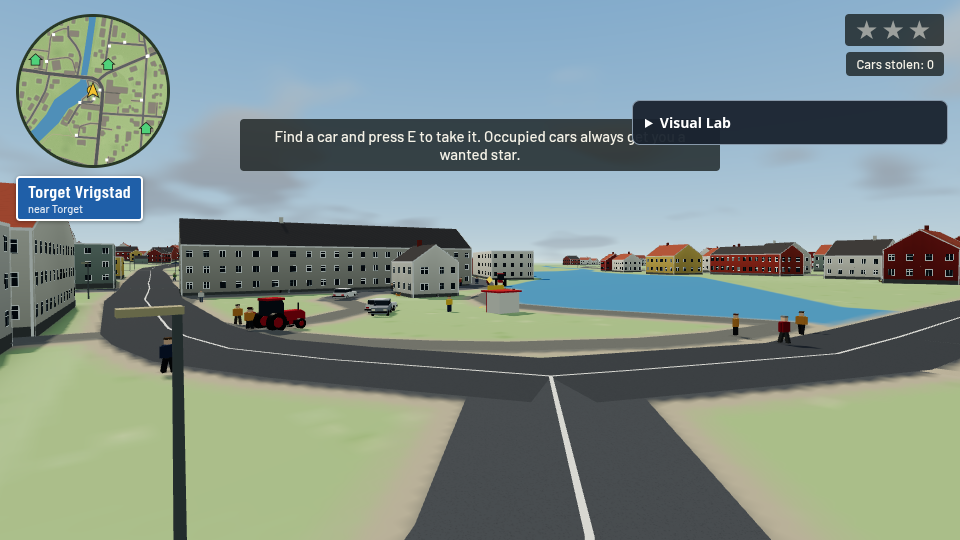
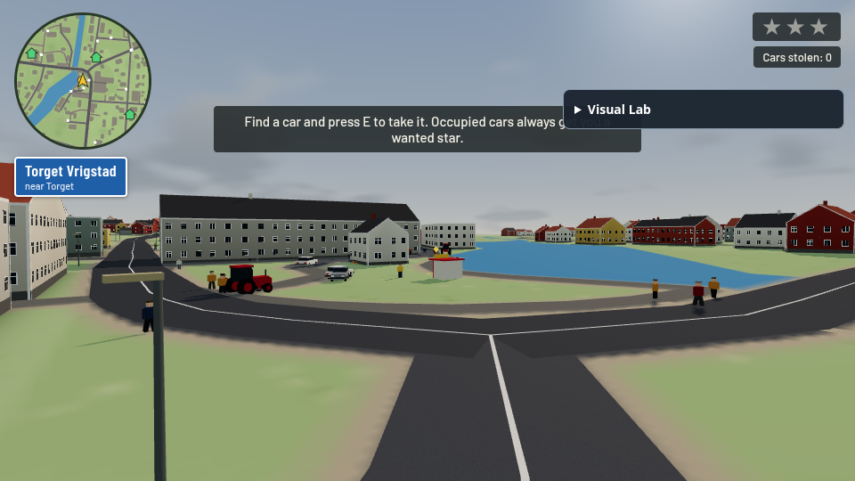
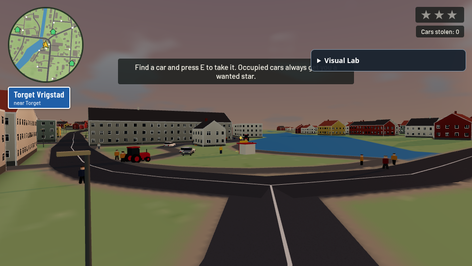
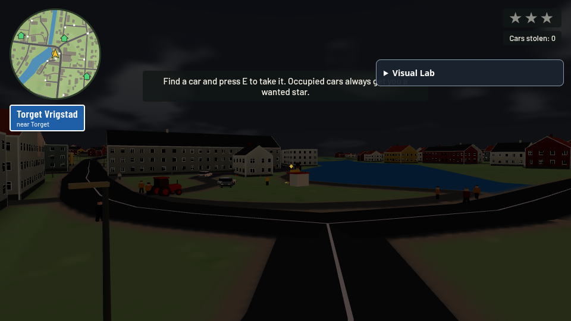
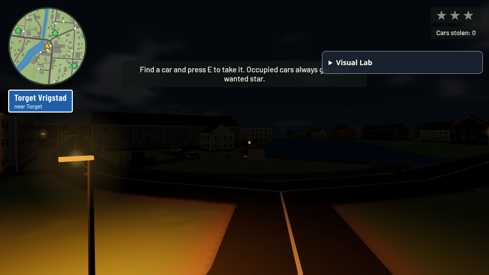
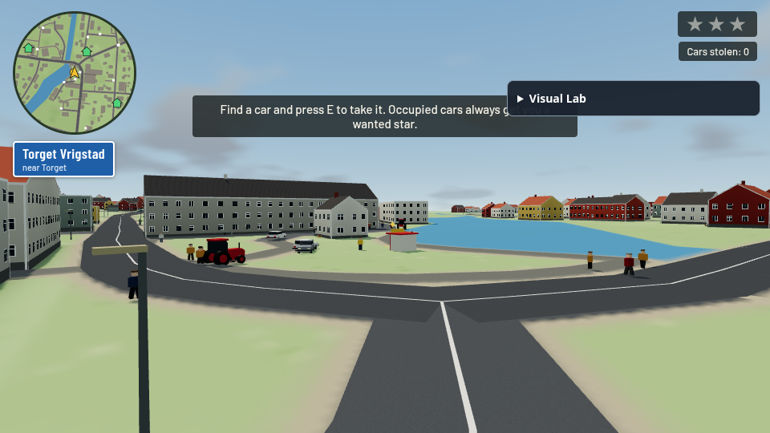
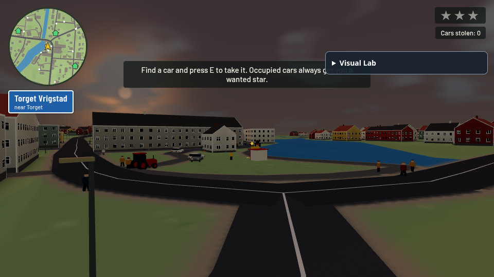
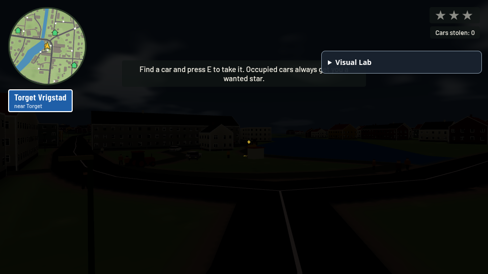
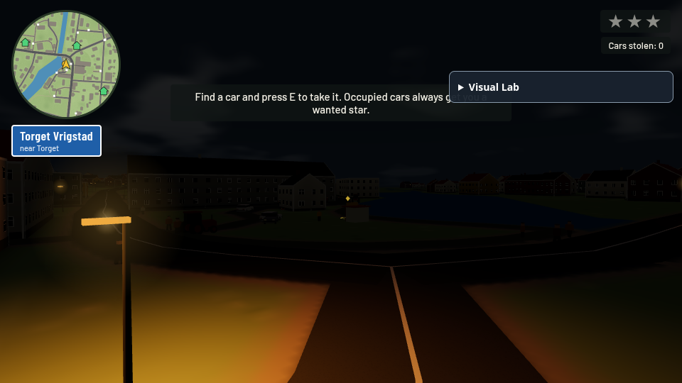

# Geographic daylight, weather and sodium lighting contribution

Base: exact upstream `6466a2fec685bc1d8688704da3e96c6747c295c4`; fork PR base `review/upstream-baseline-6466a2f`; head `contrib/geographic-daylight`. Part of upstream [upstream #99](https://github.com/OliverRomhagen/vrigstad-joyride/issues/99) (open), designed for [upstream #114](https://github.com/OliverRomhagen/vrigstad-joyride/issues/114)'s shared calendar (also open). This does not implement seasons, snow, holiday events or time-dependent gameplay and does not claim to close [upstream #114](https://github.com/OliverRomhagen/vrigstad-joyride/issues/114).

## Review / selective port

Upstream already has ACES/sRGB material handling, one camera-following sky dome, FogExp2, one fixed directional sun, hemisphere fill and normal gameplay shadows. It has no date/clock/weather/daylight controller, street-light system or visual development controls. The source fork (`8d7198c`) has geographic solar position, smooth multi-day cloud coverage, sodium lamps and a Visual Lab, but its controller is coupled to its custom film sky and final-pass glare.

Selected: pure Vrigstad latitude/longitude solar calculations, smooth seeded weather, sunrise/twilight light adaptation, roadside lamp placement/light pool and lighting-only controls. Reworked: the renderer adapter updates **upstream's existing dome**, hemisphere, sun, exposure and fog. No fork film pipeline, material palette, extra sky, tone mapper, encoding transfer or fullscreen pass is included. The sky's old shader path remains available through `?lighting=off`. No simulation/RNG stream changes.

A new `createSolarClock` advances absolute UTC instants while exposing Stockholm civil date/time, so solar direction remains continuous through spring skipped hours and autumn repeated hours. User-entered ambiguous autumn time selects the first occurrence; nonexistent spring time normalizes forward. URL date validates strictly, invalid dates fall back to the documented August date. Year/month/day rollover is shared by solar position and deterministic weather, including changing day length and altitude with season. The NOAA-style approximation is not a high-precision astronomical ephemeris; refraction and terrain horizon are not modeled.

## Controls

Default: August 15 2026, 15:30, continuous accelerated cycle (12 real minutes per simulated day). Use `?time=13&date=2026-06-21` for a fixed civil time/date, `?cycle=on|off`, `?daySpeed=1`, or `?lighting=off` for the upstream static lighting. `?dev=lighting` opens the collapsible DOM lab: time/date, quick times, cycle pause/run, cloud coverage, sun glare, Streetlights Auto/On/Off and Reset. It deliberately contains no color-grade or mist controls; [upstream #124](https://github.com/OliverRomhagen/vrigstad-joyride/issues/124)/#140 remain independent. Focused panel keys do not steer, pointer interaction releases held movement keys, and normal canvas input remains the original code.

Direct sunlight, sun tint, sky halo/glare and exposure are independent controls. Clouds sample the same projected noise field as the dome and smoothly reduce direct light. Unlike the fork's final-pass glare, this adapter's directional solar glow lives in the existing sky shader: geometry can occlude it and no full-scene glare/bloom pass is added. This is atmospheric sky glow, not a calibrated lens simulation.

Related [upstream #144](https://github.com/OliverRomhagen/vrigstad-joyride/issues/144) requests roadside furniture. This candidate includes lamps only, not benches/bins, and does not claim that issue complete.

## Street lights

The selected road algorithm is deterministic, alternates sides at roughly 52 m spacing, avoids building bounds, water, steep slopes and nearby road/path corridors and uses no gameplay random draws. Poles/fixtures use instancing and shared materials. All lamps can show emissive fixtures/soft depth-tested halos; only the four closest slots (two on coarse devices) emit actual non-shadow-casting PointLight illumination. Distances cap active lights at 85 m and halos at 180 m. Lambert/Phong materials receive real local light. Original upstream sRGB-to-linear color conventions are applied to the lamp materials/lights too.

Automatic activation follows solar elevation: fades on below the horizon and fully on at −6°, rather than forcing identical clock times in winter and summer. This adapts the fork's later astronomical schedule to the seasonal requirements. Distance selection is not full visibility ranking. Shadowless point lights can leak through walls; halo depth testing does not solve point-light leakage. No headlights are included, so unlit remote roads remain dark.

Terrain and road materials use black-specular Phong diffuse lighting while this system is enabled: r128 Lambert is vertex-lit, so the coarse terrain grid otherwise produces large triangular point-light patches. This is a focused local-lighting correction, not a palette or specular retune. `lighting=off` constructs the original Lambert ground materials. The r187 upgrade changes Lambert to per-pixel lighting and may make this adapter unnecessary.

## Files and verification

- `src/visual/daylight.mjs`: pure solar/weather/calendar plus renderer adapter.
- `src/visual/street-lighting.mjs`: pure placement/schedule plus fixed light pool.
- `src/visual/visual-lab.js`: optional DOM UI.
- `src/game.html`: names the existing hemisphere light, expands the existing dome shader, wires updates/read-only state and embeds modules.
- `tools/build.py`/generated `index.html`: normal build path; no manual generated HTML merge.
- `tools/check_daylight.mjs`: noon altitude, east/west direction, seasonal differences, bounded weather/exposure, multi-day continuity, invalid dates, year rollover, and both Stockholm DST transitions.
- `tools/check-lighting-lab.mjs`: lamp schedule, deterministic placement, blocked footprint/slope rejection and cloud/exposure checks.

`docs/review-daylight/` contains actual browser game screenshots at 13/17/19/20:30/22, summer/winter noon and lamp off/on. `results.json` records real state/counts and browser errors. Tests do not infer visual success from a build. The game/map smoke suite and reduced software environment are documented in the final verification results.

## Remaining risks

Current-main r128 patch: Vite [upstream #143](https://github.com/OliverRomhagen/vrigstad-joyride/pull/143) and Three.js [upstream #147](https://github.com/OliverRomhagen/vrigstad-joyride/pull/147) are open and will require a source-level rebase. No parallel sky/film renderer should be introduced during that rebase. Exposure and tint are artistic; all seasons/weather combinations need human review. No hardware GPU/mobile signoff is available. Fixed point-light slots add per-material shader work even when their intensity is zero; halos add nearby sprite draws. Long manual driving and touch interaction still need review. Future [upstream #114](https://github.com/OliverRomhagen/vrigstad-joyride/issues/114) should consume this one clock instead of starting another date/time model.

## Reproducing the software review

Install the existing development dependencies and Chromium, then run:

```sh
python3 tools/build.py
node tools/run-software-smoke.cjs
node tools/review-rendering.cjs
```

The software smoke runner copies the repository's existing assertion bodies into `work/software-smoke`, changes only their import to a page fixture, and intercepts HTML responses to suppress WebGL submissions and repeated minimap texture drawing during **functional-only** smoke assertions. The functional profile also uses a 128-pixel ground texture to avoid large 2D raster work. Normal input, simulation, camera and DOM text/state updates continue; minimap pixel rendering is checked only in the separate real captures. These tests establish state/UI behavior, not shader compilation or rendered play, and their screenshots are not visual evidence. All actual rendering/shader verification is performed separately by the full-shadow browser review captures. CSS viewport remains 1280×720 at device scale 0.5; timeouts are longer. It does not change checked-in game sources or assertion bodies. `work/` is temporary review output. Full-shadow visual captures and measurements are a separate run at 960×540, with fixed-step simulation and a camera hook injected only into browser responses. Thus passing the reduced suite is not presented as default-resolution/shadow/mobile signoff. Keep the normal `npm run test:e2e` CI job too.

## Browser captures

Open an image to inspect the original capture.

| time-13 | time-17 | time-19 |
| --- | --- | --- |
| [](review-daylight/time-13.png) | [](review-daylight/time-17.png) | [](review-daylight/time-19.png) |

| time-20.5 | time-22 | 2026-06-21 |
| --- | --- | --- |
| [](review-daylight/time-20.5.png) | [](review-daylight/time-22.png) | [](review-daylight/2026-06-21.png) |

| 2026-12-21 | street-off | street-on |
| --- | --- | --- |
| [](review-daylight/2026-12-21.png) | [](review-daylight/street-off.png) | [](review-daylight/street-on.png) |


## Final observed results

Pure solar/weather/calendar and street placement/schedule tests passed, including both 2026 Stockholm DST transitions and year rollover. Python build and embedded script syntax passed. Final full-shadow WebGL run produced nine screenshots with zero reported shader/page/console errors; every capture records `MeshPhongMaterial` for the updated ground, confirming that the per-pixel correction was actually rendered. The panel blocked driving keys in the real control-event check.

The captured map has **302** deterministically placed lamps, four real light slots, zero active daylight slots and four active slots at 22:00. Summer noon elevation was 56.09°, winter noon 8.24°. No new color-grade or grain pass is present. All five original state/UI smoke assertions passed in the documented reduced functional profile after the material correction. Original uninstrumented baseline testing had two software-render timing failures (3/5 passed), so default full-render CI/hardware is not declared green by this report.
