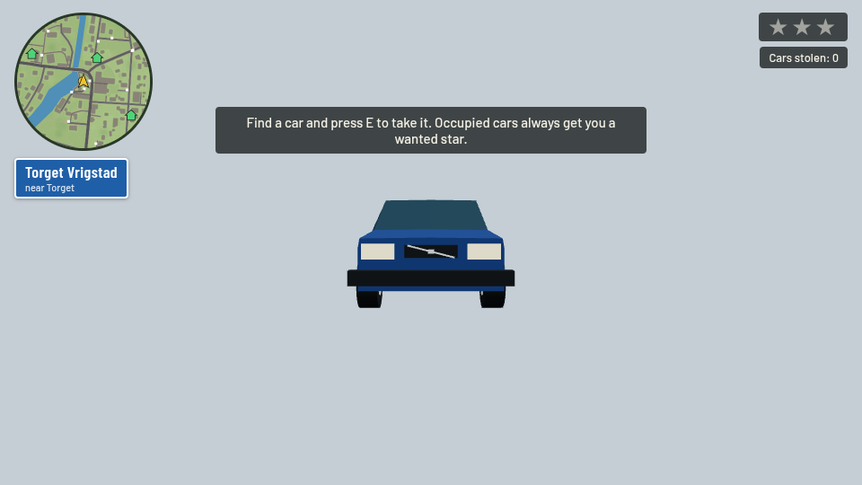
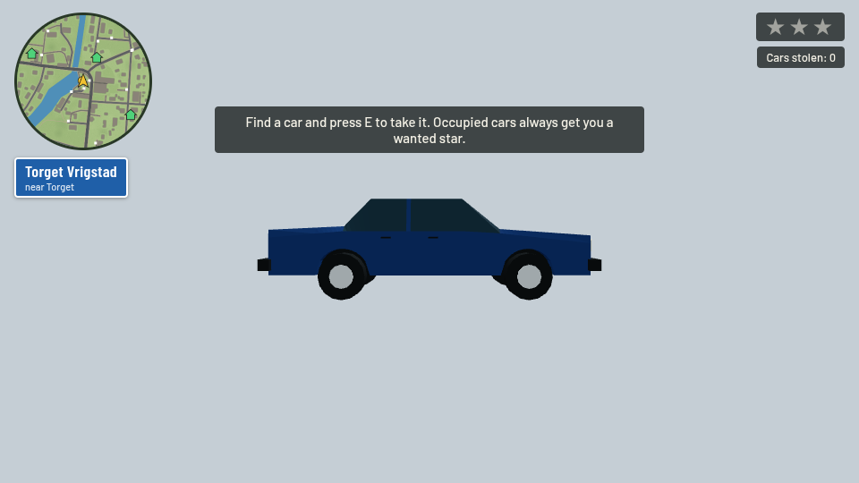
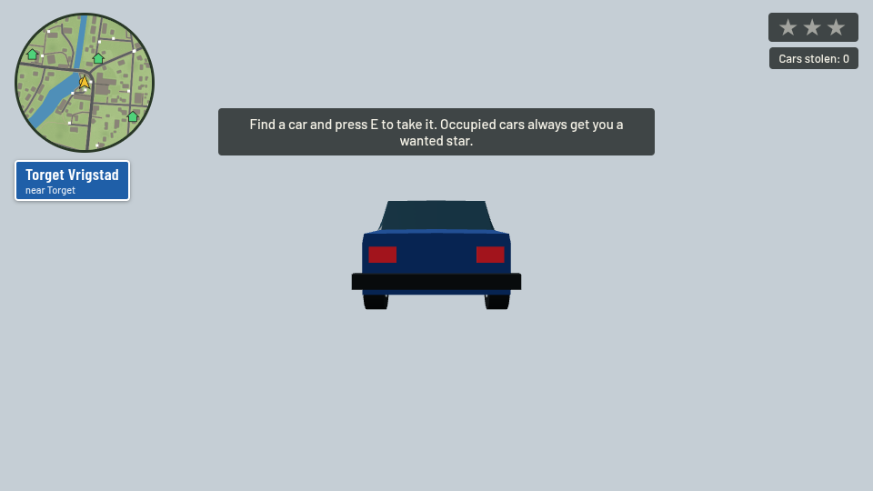
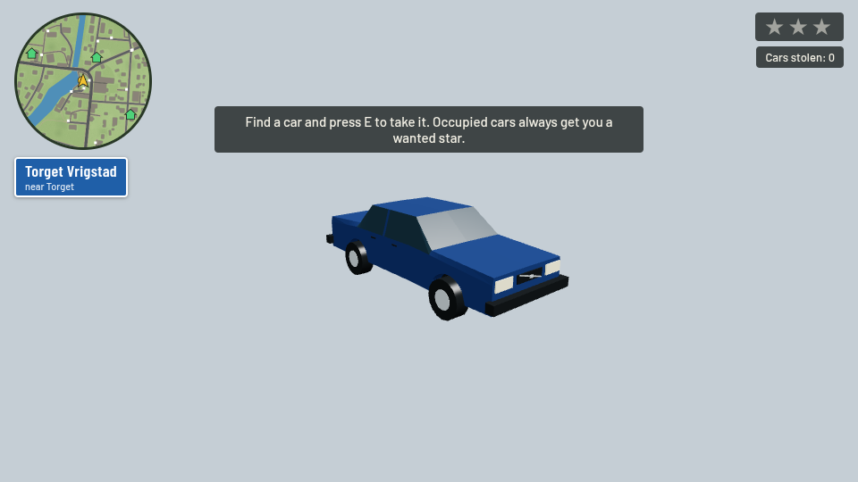
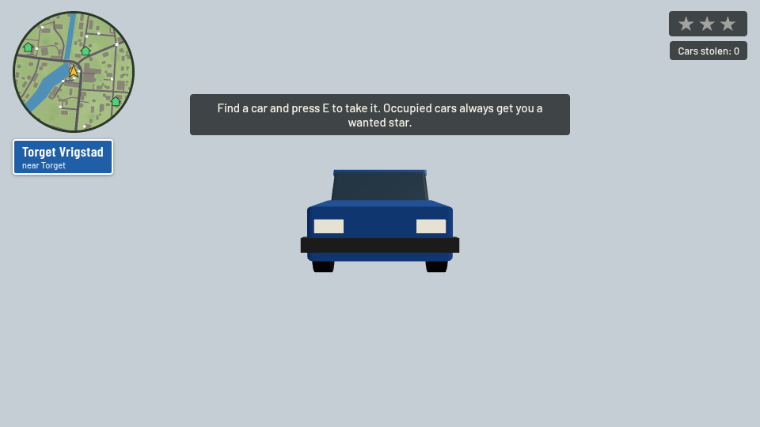
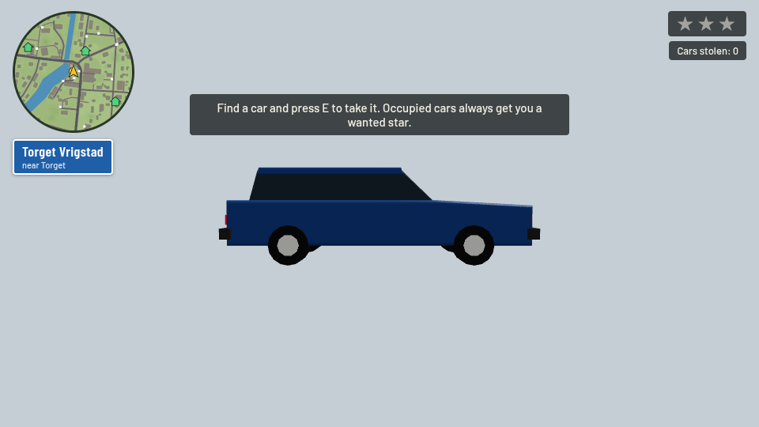
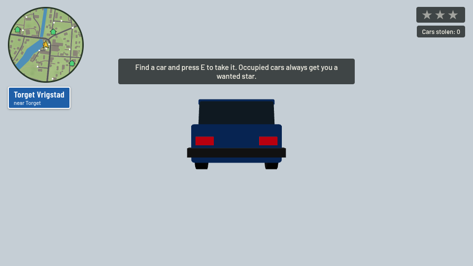
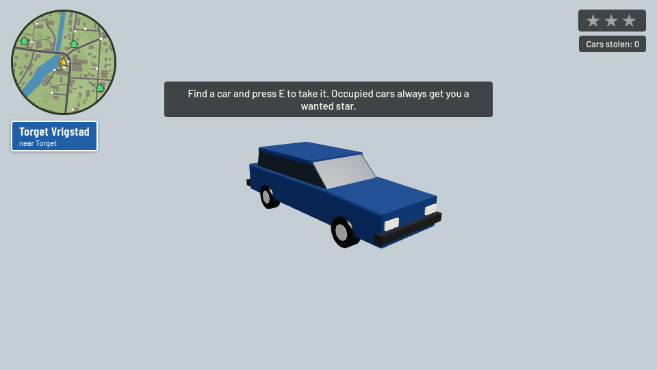

# Volvo 240: independently reviewed geometry contribution

Target: upstream `6466a2fec685bc1d8688704da3e96c6747c295c4`; fork PR base `review/upstream-baseline-6466a2f`; head `contrib/volvo-240-geometry`. No upstream branches/issues/PRs are created. No dedicated open model-geometry issue was found; related [upstream #19](https://github.com/OliverRomhagen/vrigstad-joyride/issues/19) concerns world assets. [upstream #87](https://github.com/OliverRomhagen/vrigstad-joyride/issues/87) concerns drivetrain behavior and is explicitly **not resolved** by this contribution.

## What already exists / what was selected

Upstream already draws this vehicle using bevelled extrusions for body, opaque glazing and roof, with round wheels, glossy Phong paint and cached geometry. Physics, collision radius, spawn types, colors and RNG are already independent from the geometry factory.

The fork (`8d7198c`, `src/vehicles/vehicle-library.mjs`) has a more specific Volvo 240 silhouette, but raw welded-edge inspection of its actual generated data found 1030 triangles and 528 boundary edges, along with mixed shared-edge winding. Several are legitimate separate detail/window surfaces; these counts are **not** proof that every boundary is a visible body hole. They do show that the whole experimental assembly cannot be presented as a verified closed body. Some fork helper boxes have inward winding and wheels omit their inner cap. It is not copied wholesale or rendered DoubleSide to hide orientation errors.

This contribution selectively reworks the proportions into a small closed station loft: distinct sedan hood, flat roof, upright greenhouse, rear window and separate trunk; 2.64 m axle separation. Paint/glass are face color regions on one connected shell, with integrated pillar bands. Wheels/rims use closed cylinders with their own normals. Bumpers, grille and lamps remain separate closed details. Every part is merged once per cached paint into the existing upstream car material/draw path. sRGB paint is converted to linear vertex colors once, matching upstream `mergeGeo`.

`src/vehicles/volvo.mjs` replaces only the `volvo` geometry branch of `softCar()`. All other vehicles use upstream's original factory. `TYPES`, collision, steering, traffic/police logic, driver inputs and RNG are unchanged. `tools/build.py` embeds only this model module and rebuilds `index.html`. No model library for unrelated vehicles is added.

## Actual geometry verification

`node tools/check-vehicle.mjs` evaluates generated body data: all edges have two opposite incidences, one connected body component, positive signed volume, unit finite normals, plausible dimension bounds and a body budget under 600 triangles. These are body-shell assertions; separate closed wheels/details are expected components. The browser review instantiates the actual final `THREE.BufferGeometry`, checks finite normals, records total triangle count/bounds and renders with the existing **FrontSide** material from front/side/rear/three-quarter views. No image generation or conceptual renders are used.

See `docs/review-volvo/results.json`, the four model views and `game.png`. Rendered model views use an isolated inspection light rig for visibility; the game image uses the unchanged real upstream map and lighting. The existing game/map smoke suite also exercises keyboard movement, entry into the parked Volvo and kiosk/cats; this does not establish a long driving-session signoff.

## Remaining limits

This is stylized procedural geometry, not a surveyed/licensed production mesh. Circular wheel-arch samples raise the closed underbody through each wheelhouse; this retains an outward manifold shell rather than attaching disconnected side panels. A grille diagonal/badge and handles add selected visual identity details. The wheelhouse spans the underside across the car; inner engine/axle details and tyre clearance still need human review. Windows are opaque; there is no interior. No unrelated drivetrain claim, no changes for [upstream #87](https://github.com/OliverRomhagen/vrigstad-joyride/issues/87). Hardware/mobile performance and human reference-photo signoff remain required before upstream submission. The model uses the same one-mesh-per-car render path and no added material variants.

Open upstream [upstream #143](https://github.com/OliverRomhagen/vrigstad-joyride/pull/143)/#147 change build/Three.js APIs. This current-main patch must be rebased at the geometry factory after those merge; do not hand-merge generated HTML.

## Reproducing the software review

Install the existing development dependencies and Chromium, then run:

```sh
python3 tools/build.py
node tools/run-software-smoke.cjs
node tools/review-rendering.cjs
```

The software smoke runner copies the repository's existing assertion bodies into `work/software-smoke`, changes only their import to a page fixture, and intercepts HTML responses to suppress WebGL submissions and repeated minimap texture drawing during **functional-only** smoke assertions. The functional profile also uses a 128-pixel ground texture to avoid large 2D raster work. Normal input, simulation, camera and DOM text/state updates continue; minimap pixel rendering is checked only in the separate real captures. These tests establish state/UI behavior, not shader compilation or rendered play, and their screenshots are not visual evidence. All actual rendering/shader verification is performed separately by the full-shadow browser review captures. CSS viewport remains 1280×720 at device scale 0.5; timeouts are longer. It does not change checked-in game sources or assertion bodies. `work/` is temporary review output. Full-shadow visual captures and measurements are a separate run at 960×540, with fixed-step simulation and a camera hook injected only into browser responses. Thus passing the reduced suite is not presented as default-resolution/shadow/mobile signoff. Keep the normal `npm run test:e2e` CI job too.

## Browser captures

Open an image to inspect the original capture.

| front | side | rear |
| --- | --- | --- |
| [](review-volvo/front.png) | [](review-volvo/side.png) | [](review-volvo/rear.png) |

| threequarter | game |
| --- | --- |
| [](review-volvo/threequarter.png) | [](review-volvo/game.png) |


## Matched upstream comparison and observed results

The baseline views below were captured from exact unchanged upstream `6466a2f` in the same browser, inspection lights, paint, camera and material as the candidate. The HUD still shows the game location during isolated model inspection; it is not part of the model. Baseline geometry/state evidence is in `baseline-results.json`. To repeat, run this branch’s review tool with `REVIEW_ROOT` pointing to an unchanged upstream checkout, `REVIEW_BASELINE=1` and a free `REVIEW_PORT`; then run normally in this branch.

| View | Unchanged upstream | Candidate |
| --- | --- | --- |
| front | [](review-volvo/baseline-front.png) | [](review-volvo/front.png) |
| side | [](review-volvo/baseline-side.png) | [](review-volvo/side.png) |
| rear | [](review-volvo/baseline-rear.png) | [](review-volvo/rear.png) |
| threequarter | [](review-volvo/baseline-threequarter.png) | [](review-volvo/threequarter.png) |

The generated candidate body has **462 triangles**, a connected manifold shell and outward winding. The complete cached render geometry has **1114 triangles**, versus **684** upstream (63% more). The draw/material path remains one mesh per car, but the additional geometry is a real cost; hardware performance has not been measured. Final bounds are 1.82 m wide, 4.84 m long and approximately 1.448 m high.

The final five actual WebGL captures have no reported page/console/shader errors, finite normals and FrontSide materials. No body-through gaps were observed in these views; the topology check, rather than those views alone, establishes shell closure. The full five original state/UI smoke assertions passed during the port in the reduced functional profile. After the final wheelhouse/glass refinement the movement/car-entry smoke was repeated and passed; final geometry checks/build and full-render captures were also repeated. The suite enters the original parked Volvo, including on the Saab branch; it is not a dedicated Saab driving test. The original uninstrumented clean-upstream suite had two software timing failures (3/5 passed), so default full-render CI is not declared green.

Selected visual gains: the baseline’s long rectangular greenhouse now has front/rear rakes and integrated pillars, visible wheel arches, a separate sedan trunk, grille diagonal/badge and handles. The new silhouette is lower and slightly shorter. Human judgement of the 240 likeness remains a Draft review item.
